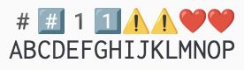
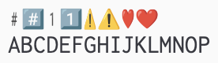

<table>
	<thead>
    	<tr>
      		<th style="text-align:center">日本語</th>
      		<th style="text-align:center"><a href="README_en.md">English</a></th>
    	</tr>
  	</thead>
</table>

# NCemojiTT (サイズ等改変版 Noto Color Emoji)

CJK 等幅フォント用にサイズなどを調整した [Noto Color Emoji](https://github.com/googlefonts/noto-emoji) です。  
em size = width で line gap = 0 のため、フォールバックフォントに指定した際にレイアウトが崩れにくいと思われます。  
様々な環境に対応できるように CBDT、COLRv1、sbix、OT-SVG の各フォーマットを用意しました。

## バリエーション

### NCemojiTT-*.ttf

- 標準版。全てのグリフが全角幅になっています。

### NCemojiTTTM-*.ttf

- ターミナルエミュレータ対応版。
- テキストスタイルが Fullwidth、Wide ではない文字を半角幅にしています。

  

## ダウンロード

[Releases](https://github.com/omonomo/NCemojiTT/releases) からお願いいたします。

[Homebrew](https://brew.sh/ja/) でもインストールできます。[こちら](https://github.com/omonomo/homebrew-tap)をご参照下さい。

フォントやスクリプトの使用は自己責任にてお願いいたします。  
各ファイルを使用することで生じた不具合・損害等について omonomo は責任を負いません。  

## ライセンス

- フォントのライセンスは [SIL Open Font License v1.1](https://github.com/omonomo/NCemojiTT/blob/main/OFL.txt) です。
- 素材フォントの[ライセンス](https://github.com/googlefonts/noto-emoji/blob/main/LICENSE)を継承しています。
- 生成スクリプトのライセンスは [MIT License](https://github.com/omonomo/NCemojiTT/blob/main/LICENSE.txt) です。

## 生成スクリプトについて

- 生成には [nanoemoji](https://github.com/googlefonts/nanoemoji) や [FontTools](https://github.com/fonttools/fonttools) を利用しています。  
- 今回は使用していませんが CFF フォーマットにも対応しています ([cffsubr](https://github.com/adobe-type-tools/cffsubr) を利用)。

## メモ

- 生成スクリプト作成に生成 AI を利用しています。
- カラー絵文字は OS やアプリケーションの対応状況がまちまちのため、思い通りに表示されない可能性があります。ご了承願います。

## リンク

自作した改変・合成フォントです。

### 全角英数や半角カナが判別しやすい、文字間隔調整機能付き等幅フォント

- [Cyroit](https://omonomo.github.io/Cyroit/): Inconsolata + Circle M+ 1m + BIZ UDゴシック + NINJAL 変体仮名フォント + Nerd Fonts
- [Idroit](https://omonomo.github.io/Idroit/): Monoid + Cyroit
- [Jeroit](https://omonomo.github.io/Jeroit/): JetBrains Mono + Cyroit
- [Meroit](https://omonomo.github.io/Meroit/): Meslo LG + Hack + Cyroit
- [Roroit](https://omonomo.github.io/Roroit/): Roboto Mono + Noto Sans Mono + Cyroit
- [Soroit](https://omonomo.github.io/Soroit/): Source Code Pro + Hasklig + Cyroit
- [Ubroit](https://omonomo.github.io/Ubroit/): Ubuntu Mono + Cyroit
- [Viroit](https://omonomo.github.io/Viroit/): Victor Mono + Cyroit

### 全角英数や半角カナが判別しやすいプロポーショナルフォント

- [Awroit](https://omonomo.github.io/Awroit/): iA Writer Quattro + IBM Plex Mono + Cyroit

### 開発用途向けにカスタマイズした日本語等幅フォント

- [日本語フォント開発用途化計画](https://github.com/omonomo/JPMonoFonts)

### CJK等幅フォント用にサイズ調整したカラー絵文字

- [TwemojiTT](https://github.com/omonomo/TwemojiTT): Twemoji
